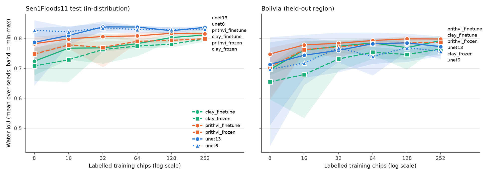

# Geospatial foundation models vs. a U-Net for surface water

**When does a 300M-parameter geospatial foundation model earn its compute for
mapping surface water, and when does a 7.8M-parameter U-Net do just as well?**

This repository benchmarks NASA/IBM **Prithvi-EO-2.0-300M** and **Clay v1.5**
against a task-specific **U-Net** trained from scratch for water extent
segmentation on Sentinel-2. It measures accuracy as a function of the number
of labelled training chips (8 → 252) to quantify label-efficiency gains in
data-scarce settings, and pairs every accuracy number with a measured cost.

It contains:

* **Fine-tuning protocols** for frozen-encoder and full fine-tuning, with a
  fixed step budget, nested label subsets and matched seeds, so arms are
  compared on equal terms ([docs/PROTOCOL.md](docs/PROTOCOL.md)).
* **Evaluation code**: sliding-window inference, pixel-pooled IoU/F1 with a
  chip-level bootstrap, matched-seed comparisons, and label-multiplier
  curves.
* **Cost accounting**: parameters, FLOPs (attention included), training
  time, peak memory, GPU energy and inference throughput per km², plus a
  data-driven verdict on whether each gain justifies its overhead
  ([docs/COST_ACCOUNTING.md](docs/COST_ACCOUNTING.md)).

## Findings

From the full sweep: 6 arms × 6 label budgets × 5 seeds = 180 runs, all on
one A100 80GB type (UVA Rivanna). Every number below is in
[results/RESULTS.md](results/RESULTS.md), which `swbench-report` regenerates
from [results/all_runs.csv](results/all_runs.csv).



**1. On the flood events it was trained on, the U-Net wins at every label
budget, even 8 chips.** Test water IoU at N = 8 → 252: `unet13` 0.787 →
0.837, `unet6` 0.826 → 0.831, best foundation model (`prithvi_finetune`)
0.782 → 0.815. Against `unet13` on matched seeds, no foundation-model arm
has a positive mean gain at any budget; 22 of 24 (arm, N) cells are `not
justified` (whole 95% CI below +0.02 IoU), and the other 2 (both arms at
N = 8) are `inconclusive`.

**2. On the unseen basin (Bolivia), fine-tuned Prithvi is the only arm ahead
of the U-Net at every budget, but the evidence is not conclusive.** Its
matched-seed gain over `unet13` is +0.011 to +0.035 IoU at every N, and it
wins on 4 of 5 seeds at N = 16, 128 and 252. In label terms, the U-Net needs
2.4×, 3.5× and 2.9× as many chips to match it at N = 8, 16 and 32, and never
matches it within 252 chips at N ≥ 64. Only at N = 252 does the CI exclude
zero (+0.025, CI +0.004 to +0.047), and no budget clears the pre-set +0.02
bar, so every verdict is `inconclusive`. Bolivia is one event of 15 chips.

**3. Pretraining buys stability more than accuracy at low N.** With 8
labelled chips, the seed-to-seed standard deviation of Bolivia IoU is 0.120
for `unet13` and 0.147 for `unet6`, against 0.030 for `prithvi_finetune`
(test: 0.085 vs. 0.025). Which 8 chips get labelled matters far less to the
pretrained model.

**4. Clay is worse than Prithvi in both protocols at about 4× the compute,**
and `clay_frozen` is the weakest arm at almost every budget.

**5. The cost is large and, for inference, permanent.** Measured throughput
on the A100: `unet13` maps 11,300 km²/s, Prithvi 4,150 km²/s (2.7× slower)
and Clay 1,300 km²/s (8.7× slower). Training needs 2.4× (`prithvi_frozen`)
to 29× (`clay_finetune`) the U-Net's FLOPs, and up to 15× its peak GPU
memory (11.8 GB vs. 0.8 GB).

**Where the overhead is justified, and where it is not.** For mapping water
in regions like the ones you have labels for, it is not: the U-Net is more
accurate and 2.7–8.7× cheaper per km², whether you have 8 labelled chips or
252. For transferring to a basin with no labels of its own, fine-tuned
Prithvi is the one candidate: consistently, if modestly, more accurate,
roughly 2–3× more label-efficient at 8–32 chips and much less sensitive to
which chips are labelled, for 6.8× the training FLOPs and 2.7× the inference
cost. Establishing that gain firmly needs more held-out basins than one
15-chip event. Clay is not justified in this setup.

### Caveats

* Sen1Floods11 is Sentinel-2 **L1C**; Prithvi was pretrained on HLS surface
  reflectance and Clay on L2A, a domain shift that handicaps both
  foundation models and not the U-Nets.
* One light decoder for both foundation models; a heavier one (e.g.
  UPerNet) might favour fine-tuning.
* The fixed 2,000-step budget treats every arm equally, but the fine-tuned
  foundation models were still improving at the last step during LR tuning.
* `clay_frozen`'s tuned LR is still on the edge of the grid
  ([docs/PROTOCOL.md](docs/PROTOCOL.md#learning-rates)).
* Measured training seconds for the small arms were bound by data loading,
  so training cost is compared in FLOPs
  ([docs/COST_ACCOUNTING.md](docs/COST_ACCOUNTING.md)).

## Benchmark design

| arm | model | weights | trained | bands |
|---|---|---|---|---|
| `unet13` (baseline) | U-Net | random | all 7.8M | 13 S2 bands |
| `unet6` | U-Net | random | all 7.8M | Prithvi's 6 bands |
| `prithvi_frozen` | Prithvi-EO-2.0-300M | pretrained | decoder (3.8M) | 6 |
| `prithvi_finetune` | Prithvi-EO-2.0-300M | pretrained | all 308M | 6 |
| `clay_frozen` | Clay v1.5 large | pretrained | decoder (3.8M) | 10 |
| `clay_finetune` | Clay v1.5 large | pretrained | all 315M | 10 |

* **Data**: Sen1Floods11 hand-labelled Sentinel-2 chips; official
  train / valid / test splits plus the **held-out Bolivia** event as an
  unseen-basin test.
* **Label budgets**: N ∈ {8, 16, 32, 64, 128, 252}, nested per seed, 5 seeds,
  identical chips across arms.
* **Training**: 2,000 steps × batch 8 for every arm and every N, CE + Dice,
  AdamW + cosine, best-val-IoU checkpoint.
* **Evaluation**: full 512 px chips by 224 px sliding window; water IoU
  pooled over valid pixels; bootstrap CIs; matched-seed deltas.

`unet6` vs. `prithvi_*` isolates **pretraining**; `unet13` vs. `prithvi_*`
answers the practical question (**would I be better off with the foundation
model than with the U-Net I'd actually train?**).

## Compute cost at a glance

Measured with `swbench-cost --skip-latency` (architecture-only, device
independent; see [results/static_profile.csv](results/static_profile.csv)):

| arm | params | GFLOPs / 224 px tile | GFLOPs / km² inference | training run (PFLOPs) | × U-Net (infer / train) |
|---|---|---|---|---|---|
| `unet13` | 7.8M | 18.8 | 6 | 0.90 | 1.0× / 1.0× |
| `prithvi_frozen` | 307.7M | 127.1 | 44 | 2.14 | 6.8× / 2.4× |
| `prithvi_finetune` | 307.7M | 127.1 | 44 | 6.09 | 6.8× / 6.8× |
| `clay_frozen` | 315.2M | 547.0 | 188 | 9.07 | 29.1× / 10.1× |
| `clay_finetune` | 315.2M | 547.0 | 188 | 26.23 | 29.1× / 29.3× |

Inference overhead is permanent (paid per km², per scene), training overhead
is paid once. Clay costs ~4× Prithvi at the same size because 8 px patches
give it 4× the tokens. Measured on an A100 80GB
([results/profiles.csv](results/profiles.csv)), the inference gap is smaller
than the FLOP ratio suggests, because the ViTs use the GPU more efficiently:
`unet13` 11,300 km²/s, Prithvi 4,150 km²/s (2.7× slower), Clay 1,300 km²/s
(8.7× slower).

## Quick start

```bash
pip install -e '.[fm,energy,dev]'      # fm = TerraTorch (Prithvi + Clay loaders)
python scripts/download_sen1floods11.py --out data/sen1floods11   # ~0.7 GB, no credentials

# one cell
swbench-train configs/arms/prithvi_frozen.yaml label_budget=16 seed=0

# the full grid (180 runs); one shard per GPU
for i in 0 1 2 3; do CUDA_VISIBLE_DEVICES=$i swbench-sweep configs/sweep.yaml --shard $i/4 & done; wait

# GPU latency / throughput / memory per arm
swbench-cost configs/arms/{unet13,unet6,prithvi_frozen,prithvi_finetune,clay_frozen,clay_finetune}.yaml --out results/profiles.csv

# tables, label-efficiency curves, verdicts -> results/RESULTS.md
swbench-report --runs runs --out results --profiles results/profiles.csv
```

Pretrained weights are downloaded from Hugging Face on first use
(`ibm-nasa-geospatial/Prithvi-EO-2.0-300M`, `made-with-clay/Clay`
`v1.5/clay-v1.5.ckpt`). For offline clusters, download them once and set
`model.kwargs.ckpt_path=/path/to/ckpt`.

A CPU-only sanity check of the whole pipeline on real chips (minutes, not a
result): `swbench-sweep configs/sweep_smoke.yaml --out runs_smoke`.

### On a Slurm cluster

`slurm/` runs the same pipeline as array jobs. Defaults target UVA
Rivanna/Afton (`gpu` partition, one A100 80GB per task); set your allocation
and any site differences in [slurm/env.sh](slurm/env.sh).

```bash
bash slurm/setup.sh                    # login node: venv, data and weights on /scratch
slurm/submit.sh check                  # GPU node: GPU visible, weights load, tests pass
slurm/submit.sh lr                     # 15 LR-tuning runs (valid split only)
python scripts/summarize_lr.py /scratch/$USER/swbench/runs_lr   # commit the chosen LRs to configs/arms/
slurm/submit.sh sweep                  # 6 array jobs x 30 cells; rerun to fill in any that failed
slurm/submit.sh cost                   # latency / throughput -> results/profiles.csv
swbench-report --runs /scratch/$USER/swbench/runs --out results --profiles results/profiles.csv
```

Every arm runs on the same GPU type so the training-time and energy columns
are comparable; the report lists the device(s) it found. Copy the run
directories off `/scratch` when the sweep finishes: they are the provenance
for every number in the report.

## Repository layout

```
configs/            base protocol, one YAML per arm, sweep grids
docs/               PROTOCOL.md (fine-tuning protocol), COST_ACCOUNTING.md
scripts/            dataset download, band statistics, LR-tuning summary
slurm/              cluster setup and array jobs (LR tuning, sweep, cost profiling)
src/swbench/
  data/             Sen1Floods11 loader, band specs and normalisation
  models/           U-Net, Prithvi / Clay adapters, shared ViT decoder
  train/engine.py   one (arm, N, seed) run: train, select on val, test
  eval/             sliding-window inference, metrics, bootstrap
  cost/             FLOP / latency / memory profiler, NVML energy meter
  analysis/         aggregation, label multipliers, verdicts, figures, report
tests/              unit + end-to-end tests (synthetic GeoTIFFs; real FM graphs if TerraTorch is installed)
```

## Limitations

Sen1Floods11 imagery is Sentinel-2 L1C while Prithvi (HLS) and Clay (L2A)
were pretrained on surface reflectance; Bolivia is a single 15-chip event;
the temporal and location inputs of both GFMs are unused. Details and their
expected direction of bias are in [docs/PROTOCOL.md](docs/PROTOCOL.md#known-limitations).

## Citation

Data: Bonafilia et al., *Sen1Floods11: a georeferenced dataset to train and
test deep learning flood algorithms for Sentinel-1*, CVPR Workshops 2020.
Models: Szwarcman et al., *Prithvi-EO-2.0*, 2024; Clay Foundation, *Clay v1.5*.

License: MIT.
