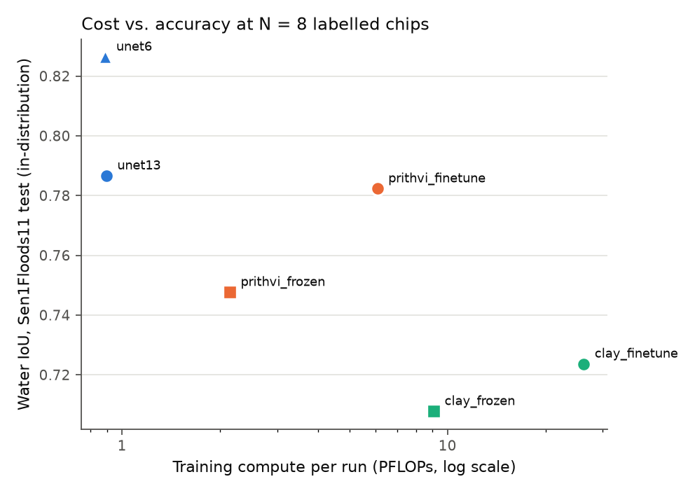

# Results

Generated by `swbench-report` from 180 runs (6 arms × 6 label budgets × up to 5 seeds). Device(s): NVIDIA A100-SXM4-80GB.

## Water IoU – test

Mean ± std over seeds.

| arm | N=8 | N=16 | N=32 | N=64 | N=128 | N=252 |
|---|---|---|---|---|---|---|
| clay_finetune | 0.724 ± 0.042 | 0.767 ± 0.028 | 0.768 ± 0.041 | 0.782 ± 0.024 | 0.803 ± 0.008 | 0.811 ± 0.010 |
| clay_frozen | 0.708 ± 0.035 | 0.729 ± 0.051 | 0.763 ± 0.006 | 0.774 ± 0.009 | 0.781 ± 0.011 | 0.798 ± 0.005 |
| prithvi_finetune | 0.782 ± 0.025 | 0.798 ± 0.018 | 0.806 ± 0.006 | 0.808 ± 0.010 | 0.817 ± 0.005 | 0.815 ± 0.006 |
| prithvi_frozen | 0.748 ± 0.019 | 0.778 ± 0.011 | 0.770 ± 0.037 | 0.790 ± 0.004 | 0.793 ± 0.005 | 0.799 ± 0.003 |
| unet13 | 0.787 ± 0.085 | 0.810 ± 0.026 | 0.838 ± 0.012 | 0.838 ± 0.006 | 0.825 ± 0.011 | 0.837 ± 0.005 |
| unet6 | 0.826 ± 0.012 | 0.822 ± 0.021 | 0.835 ± 0.013 | 0.829 ± 0.009 | 0.830 ± 0.008 | 0.831 ± 0.002 |

## Water IoU – bolivia

Mean ± std over seeds.

| arm | N=8 | N=16 | N=32 | N=64 | N=128 | N=252 |
|---|---|---|---|---|---|---|
| clay_finetune | 0.696 ± 0.017 | 0.761 ± 0.027 | 0.774 ± 0.019 | 0.785 ± 0.023 | 0.769 ± 0.042 | 0.793 ± 0.014 |
| clay_frozen | 0.655 ± 0.048 | 0.679 ± 0.090 | 0.731 ± 0.032 | 0.754 ± 0.015 | 0.746 ± 0.013 | 0.765 ± 0.013 |
| prithvi_finetune | 0.748 ± 0.030 | 0.778 ± 0.012 | 0.784 ± 0.007 | 0.793 ± 0.005 | 0.798 ± 0.008 | 0.798 ± 0.004 |
| prithvi_frozen | 0.705 ± 0.061 | 0.762 ± 0.008 | 0.772 ± 0.021 | 0.782 ± 0.006 | 0.785 ± 0.009 | 0.787 ± 0.001 |
| unet13 | 0.713 ± 0.120 | 0.744 ± 0.052 | 0.760 ± 0.065 | 0.782 ± 0.041 | 0.785 ± 0.037 | 0.772 ± 0.028 |
| unet6 | 0.697 ± 0.147 | 0.718 ± 0.066 | 0.769 ± 0.027 | 0.740 ± 0.057 | 0.769 ± 0.012 | 0.757 ± 0.020 |

## Label efficiency vs. `unet13` – test

`label_multiplier` = labelled chips the baseline needs to match the arm, divided by the chips the arm used (log-linear interpolation of the baseline's mean curve). `< tested range`: the baseline already does better with its smallest budget.

**clay_finetune**

| label_budget | score | baseline_equivalent_budget | label_multiplier |
|---|---|---|---|
| 8 | 0.72 | < tested range | < tested range |
| 16 | 0.77 | < tested range | < tested range |
| 32 | 0.77 | < tested range | < tested range |
| 64 | 0.78 | < tested range | < tested range |
| 128 | 0.80 | 12.96 | 0.10 |
| 252 | 0.81 | 16.55 | 0.07 |

**clay_frozen**

| label_budget | score | baseline_equivalent_budget | label_multiplier |
|---|---|---|---|
| 8 | 0.71 | < tested range | < tested range |
| 16 | 0.73 | < tested range | < tested range |
| 32 | 0.76 | < tested range | < tested range |
| 64 | 0.77 | < tested range | < tested range |
| 128 | 0.78 | < tested range | < tested range |
| 252 | 0.80 | 11.20 | 0.04 |

**prithvi_finetune**

| label_budget | score | baseline_equivalent_budget | label_multiplier |
|---|---|---|---|
| 8 | 0.78 | < tested range | < tested range |
| 16 | 0.80 | 11.27 | 0.70 |
| 32 | 0.81 | 14.41 | 0.45 |
| 64 | 0.81 | 15.30 | 0.24 |
| 128 | 0.82 | 19.00 | 0.15 |
| 252 | 0.81 | 18.15 | 0.07 |

**prithvi_frozen**

| label_budget | score | baseline_equivalent_budget | label_multiplier |
|---|---|---|---|
| 8 | 0.75 | < tested range | < tested range |
| 16 | 0.78 | < tested range | < tested range |
| 32 | 0.77 | < tested range | < tested range |
| 64 | 0.79 | 8.86 | 0.14 |
| 128 | 0.79 | 9.78 | 0.08 |
| 252 | 0.80 | 11.55 | 0.05 |

**unet6**

| label_budget | score | baseline_equivalent_budget | label_multiplier |
|---|---|---|---|
| 8 | 0.83 | 24.02 | 3.00 |
| 16 | 0.82 | 21.62 | 1.35 |
| 32 | 0.84 | 29.93 | 0.94 |
| 64 | 0.83 | 25.87 | 0.40 |
| 128 | 0.83 | 25.99 | 0.20 |
| 252 | 0.83 | 27.04 | 0.11 |

## Label efficiency vs. `unet13` – bolivia

`label_multiplier` = labelled chips the baseline needs to match the arm, divided by the chips the arm used (log-linear interpolation of the baseline's mean curve). `< tested range`: the baseline already does better with its smallest budget.

**clay_finetune**

| label_budget | score | baseline_equivalent_budget | label_multiplier |
|---|---|---|---|
| 8 | 0.70 | < tested range | < tested range |
| 16 | 0.76 | 32.62 | 2.04 |
| 32 | 0.77 | 49.01 | 1.53 |
| 64 | 0.78 | 123.06 | 1.92 |
| 128 | 0.77 | 42.42 | 0.33 |
| 252 | 0.79 | > tested range | > tested range |

**clay_frozen**

| label_budget | score | baseline_equivalent_budget | label_multiplier |
|---|---|---|---|
| 8 | 0.65 | < tested range | < tested range |
| 16 | 0.68 | < tested range | < tested range |
| 32 | 0.73 | 12.06 | 0.38 |
| 64 | 0.75 | 24.39 | 0.38 |
| 128 | 0.75 | 17.88 | 0.14 |
| 252 | 0.76 | 37.22 | 0.15 |

**prithvi_finetune**

| label_budget | score | baseline_equivalent_budget | label_multiplier |
|---|---|---|---|
| 8 | 0.75 | 18.92 | 2.36 |
| 16 | 0.78 | 56.40 | 3.52 |
| 32 | 0.78 | 92.66 | 2.90 |
| 64 | 0.79 | > tested range | > tested range |
| 128 | 0.80 | > tested range | > tested range |
| 252 | 0.80 | > tested range | > tested range |

**prithvi_frozen**

| label_budget | score | baseline_equivalent_budget | label_multiplier |
|---|---|---|---|
| 8 | 0.70 | < tested range | < tested range |
| 16 | 0.76 | 34.36 | 2.15 |
| 32 | 0.77 | 45.91 | 1.43 |
| 64 | 0.78 | 63.64 | 0.99 |
| 128 | 0.79 | > tested range | > tested range |
| 252 | 0.79 | > tested range | > tested range |

**unet6**

| label_budget | score | baseline_equivalent_budget | label_multiplier |
|---|---|---|---|
| 8 | 0.70 | < tested range | < tested range |
| 16 | 0.72 | 8.86 | 0.55 |
| 32 | 0.77 | 41.81 | 1.31 |
| 64 | 0.74 | 14.62 | 0.23 |
| 128 | 0.77 | 42.61 | 0.33 |
| 252 | 0.76 | 27.84 | 0.11 |

## Is the foundation model worth it?

Matched-seed IoU gain over `unet13` with a bootstrap 95% CI over seeds. `justified` = whole CI above +0.02 IoU; `not justified` = whole CI below it; otherwise `inconclusive`. Extra cost is relative to the baseline: measured training seconds (on the device listed above) and, when profiles are available, training PFLOPs, which the per-IoU-point rate uses. The rate is `–` when there is no gain or no extra cost.

**clay_finetune – test**

| label_budget | delta_iou | delta_lo | delta_hi | wins | extra_train_seconds | extra_train_pflops | extra_train_pflops_per_iou_point | verdict |
|---|---|---|---|---|---|---|---|---|
| 8 | -0.063 | -0.114 | -0.009 | 1/5 | 202.545 | 25.335 | – | not justified |
| 16 | -0.043 | -0.078 | -0.008 | 1/5 | 232.806 | 25.335 | – | not justified |
| 32 | -0.070 | -0.097 | -0.047 | 0/5 | 208.211 | 25.335 | – | not justified |
| 64 | -0.056 | -0.074 | -0.044 | 0/5 | 192.280 | 25.335 | – | not justified |
| 128 | -0.023 | -0.026 | -0.020 | 0/5 | 209.253 | 25.335 | – | not justified |
| 252 | -0.026 | -0.034 | -0.016 | 0/5 | 216.121 | 25.335 | – | not justified |

**clay_frozen – test**

| label_budget | delta_iou | delta_lo | delta_hi | wins | extra_train_seconds | extra_train_pflops | extra_train_pflops_per_iou_point | verdict |
|---|---|---|---|---|---|---|---|---|
| 8 | -0.079 | -0.113 | -0.032 | 1/5 | 118.625 | 8.176 | – | not justified |
| 16 | -0.081 | -0.124 | -0.040 | 0/5 | 128.712 | 8.176 | – | not justified |
| 32 | -0.076 | -0.082 | -0.069 | 0/5 | 126.881 | 8.176 | – | not justified |
| 64 | -0.064 | -0.070 | -0.058 | 0/5 | 125.376 | 8.176 | – | not justified |
| 128 | -0.045 | -0.052 | -0.036 | 0/5 | 125.615 | 8.176 | – | not justified |
| 252 | -0.039 | -0.044 | -0.034 | 0/5 | 117.555 | 8.176 | – | not justified |

**prithvi_finetune – test**

| label_budget | delta_iou | delta_lo | delta_hi | wins | extra_train_seconds | extra_train_pflops | extra_train_pflops_per_iou_point | verdict |
|---|---|---|---|---|---|---|---|---|
| 8 | -0.004 | -0.043 | 0.051 | 1/5 | 52.548 | 5.194 | – | inconclusive |
| 16 | -0.012 | -0.043 | 0.019 | 2/5 | 53.041 | 5.194 | – | not justified |
| 32 | -0.032 | -0.039 | -0.025 | 0/5 | 38.225 | 5.194 | – | not justified |
| 64 | -0.030 | -0.036 | -0.020 | 0/5 | 49.002 | 5.194 | – | not justified |
| 128 | -0.009 | -0.016 | -0.003 | 0/5 | 40.229 | 5.194 | – | not justified |
| 252 | -0.022 | -0.028 | -0.015 | 0/5 | 36.953 | 5.194 | – | not justified |

**prithvi_frozen – test**

| label_budget | delta_iou | delta_lo | delta_hi | wins | extra_train_seconds | extra_train_pflops | extra_train_pflops_per_iou_point | verdict |
|---|---|---|---|---|---|---|---|---|
| 8 | -0.039 | -0.093 | 0.028 | 1/5 | -21.612 | 1.248 | – | inconclusive |
| 16 | -0.032 | -0.057 | -0.006 | 1/5 | -22.902 | 1.248 | – | not justified |
| 32 | -0.068 | -0.104 | -0.045 | 0/5 | -45.662 | 1.248 | – | not justified |
| 64 | -0.048 | -0.053 | -0.042 | 0/5 | -31.368 | 1.248 | – | not justified |
| 128 | -0.032 | -0.044 | -0.022 | 0/5 | -38.283 | 1.248 | – | not justified |
| 252 | -0.038 | -0.041 | -0.035 | 0/5 | -35.038 | 1.248 | – | not justified |

**unet6 – test**

| label_budget | delta_iou | delta_lo | delta_hi | wins | extra_train_seconds | extra_train_pflops | extra_train_pflops_per_iou_point | verdict |
|---|---|---|---|---|---|---|---|---|
| 8 | 0.040 | -0.015 | 0.113 | 3/5 | -70.617 | -0.006 | – | inconclusive |
| 16 | 0.012 | -0.017 | 0.040 | 4/5 | -70.575 | -0.006 | – | inconclusive |
| 32 | -0.003 | -0.018 | 0.012 | 2/5 | -93.430 | -0.006 | – | not justified |
| 64 | -0.008 | -0.012 | -0.004 | 1/5 | -84.148 | -0.006 | – | not justified |
| 128 | 0.004 | -0.001 | 0.011 | 3/5 | -93.299 | -0.006 | – | not justified |
| 252 | -0.006 | -0.010 | -0.001 | 1/5 | -94.762 | -0.006 | – | not justified |

**clay_finetune – bolivia**

| label_budget | delta_iou | delta_lo | delta_hi | wins | extra_train_seconds | extra_train_pflops | extra_train_pflops_per_iou_point | verdict |
|---|---|---|---|---|---|---|---|---|
| 8 | -0.017 | -0.089 | 0.085 | 2/5 | 202.545 | 25.335 | – | inconclusive |
| 16 | 0.017 | -0.045 | 0.079 | 4/5 | 232.806 | 25.335 | 14.966 | inconclusive |
| 32 | 0.014 | -0.035 | 0.063 | 3/5 | 208.211 | 25.335 | 18.520 | inconclusive |
| 64 | 0.003 | -0.029 | 0.042 | 2/5 | 192.280 | 25.335 | 98.111 | inconclusive |
| 128 | -0.016 | -0.027 | -0.005 | 0/5 | 209.253 | 25.335 | – | not justified |
| 252 | 0.020 | 0.008 | 0.031 | 4/5 | 216.121 | 25.335 | 12.545 | inconclusive |

**clay_frozen – bolivia**

| label_budget | delta_iou | delta_lo | delta_hi | wins | extra_train_seconds | extra_train_pflops | extra_train_pflops_per_iou_point | verdict |
|---|---|---|---|---|---|---|---|---|
| 8 | -0.058 | -0.156 | 0.056 | 2/5 | 118.625 | 8.176 | – | inconclusive |
| 16 | -0.064 | -0.176 | 0.016 | 2/5 | 128.712 | 8.176 | – | not justified |
| 32 | -0.029 | -0.076 | 0.022 | 2/5 | 126.881 | 8.176 | – | inconclusive |
| 64 | -0.029 | -0.056 | 0.006 | 1/5 | 125.376 | 8.176 | – | not justified |
| 128 | -0.039 | -0.058 | -0.006 | 1/5 | 125.615 | 8.176 | – | not justified |
| 252 | -0.008 | -0.031 | 0.016 | 2/5 | 117.555 | 8.176 | – | not justified |

**prithvi_finetune – bolivia**

| label_budget | delta_iou | delta_lo | delta_hi | wins | extra_train_seconds | extra_train_pflops | extra_train_pflops_per_iou_point | verdict |
|---|---|---|---|---|---|---|---|---|
| 8 | 0.034 | -0.054 | 0.155 | 2/5 | 52.548 | 5.194 | 1.511 | inconclusive |
| 16 | 0.035 | -0.013 | 0.078 | 4/5 | 53.041 | 5.194 | 1.505 | inconclusive |
| 32 | 0.024 | -0.029 | 0.076 | 2/5 | 38.225 | 5.194 | 2.191 | inconclusive |
| 64 | 0.011 | -0.016 | 0.045 | 3/5 | 49.002 | 5.194 | 4.840 | inconclusive |
| 128 | 0.013 | -0.004 | 0.042 | 4/5 | 40.229 | 5.194 | 3.886 | inconclusive |
| 252 | 0.025 | 0.004 | 0.047 | 4/5 | 36.953 | 5.194 | 2.041 | inconclusive |

**prithvi_frozen – bolivia**

| label_budget | delta_iou | delta_lo | delta_hi | wins | extra_train_seconds | extra_train_pflops | extra_train_pflops_per_iou_point | verdict |
|---|---|---|---|---|---|---|---|---|
| 8 | -0.008 | -0.109 | 0.117 | 2/5 | -21.612 | 1.248 | – | inconclusive |
| 16 | 0.019 | -0.022 | 0.060 | 4/5 | -22.902 | 1.248 | 0.671 | inconclusive |
| 32 | 0.012 | -0.033 | 0.061 | 2/5 | -45.662 | 1.248 | 1.077 | inconclusive |
| 64 | -0.000 | -0.029 | 0.038 | 1/5 | -31.368 | 1.248 | – | inconclusive |
| 128 | 0.001 | -0.022 | 0.028 | 2/5 | -38.283 | 1.248 | 24.571 | inconclusive |
| 252 | 0.015 | -0.007 | 0.036 | 3/5 | -35.038 | 1.248 | 0.853 | inconclusive |

**unet6 – bolivia**

| label_budget | delta_iou | delta_lo | delta_hi | wins | extra_train_seconds | extra_train_pflops | extra_train_pflops_per_iou_point | verdict |
|---|---|---|---|---|---|---|---|---|
| 8 | -0.016 | -0.044 | 0.002 | 2/5 | -70.617 | -0.006 | – | not justified |
| 16 | -0.026 | -0.082 | 0.026 | 2/5 | -70.575 | -0.006 | – | inconclusive |
| 32 | 0.009 | -0.031 | 0.058 | 2/5 | -93.430 | -0.006 | – | inconclusive |
| 64 | -0.043 | -0.102 | 0.015 | 1/5 | -84.148 | -0.006 | – | not justified |
| 128 | -0.016 | -0.040 | 0.016 | 1/5 | -93.299 | -0.006 | – | not justified |
| 252 | -0.016 | -0.040 | 0.009 | 1/5 | -94.762 | -0.006 | – | not justified |

## Cost accounting

| arm | train_seconds | run_wall_seconds | train_peak_mem_gb | params_total | params_trainable | device | run_energy_kwh | test_infer_seconds | gflops_fwd_per_tile | gflops_train_per_tile | infer_ms_per_tile | infer_tiles_per_s | infer_km2_per_s | infer_peak_mem_gb | profile_device | train_pflops_per_run |
|---|---|---|---|---|---|---|---|---|---|---|---|---|---|---|---|---|
| clay_finetune | 422.063 | 499.132 | 11.807 | 315239938 | 315239938 | NVIDIA A100-SXM4-80GB | 0.038 | 7.377 | 546.971 | 1639.370 | 3.841 | 260.348 | 1306.324 | 3.779 | NVIDIA A100-SXM4-80GB | 26.230 |
| clay_frozen | 335.654 | 429.574 | 2.096 | 315239938 | 3796994 | NVIDIA A100-SXM4-80GB | 0.022 | 8.739 | 546.971 | 566.953 | 3.838 | 260.580 | 1307.485 | 4.370 | NVIDIA A100-SXM4-80GB | 9.071 |
| prithvi_finetune | 256.860 | 339.309 | 7.250 | 307692610 | 307692610 | NVIDIA A100-SXM4-80GB | 0.018 | 8.360 | 127.070 | 380.594 | 1.210 | 826.134 | 4145.209 | 3.465 | NVIDIA A100-SXM4-80GB | 6.089 |
| prithvi_frozen | 179.383 | 261.630 | 1.736 | 307692610 | 3806274 | NVIDIA A100-SXM4-80GB | 0.011 | 8.368 | 127.070 | 133.968 | 1.197 | 835.302 | 4191.212 | 1.648 | NVIDIA A100-SXM4-80GB | 2.143 |
| unet13 | 211.860 | 235.292 | 0.788 | 7765954 | 7765954 | NVIDIA A100-SXM4-80GB | 0.008 | 2.216 | 18.776 | 55.953 | 0.443 | 2256.852 | 11323.983 | 0.451 | NVIDIA A100-SXM4-80GB | 0.895 |
| unet6 | 127.388 | 142.993 | 0.774 | 7763938 | 7763938 | NVIDIA A100-SXM4-80GB | 0.006 | 1.679 | 18.574 | 55.548 | 0.408 | 2448.264 | 12284.410 | 0.429 | NVIDIA A100-SXM4-80GB | 0.889 |

**Training time is not compute-bound for every arm.** `prithvi_frozen` needs 2.4x the training FLOPs of `unet13` but trained in 179 s vs 212 s. For these arms wall-clock seconds (and GPU energy, which includes idle power) reflect data loading and node load as much as the model, so compare training cost by FLOPs, and inference cost by the profiled throughput (`infer_km2_per_s`), which is measured without data loading.

See docs/COST_ACCOUNTING.md for how each column is measured.
